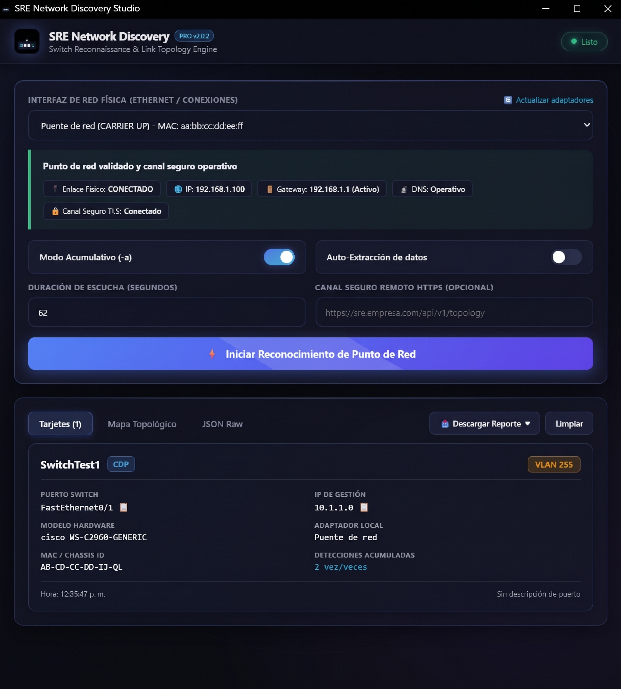

<p align="center">
  
</p>

# SRE Network Discovery v2.0.2

Herramienta de grado SRE para **descubrimiento de infraestructura de red (CDP/LLDP)** y **validación de puntos de conexión de red** en Windows.

Compilada de forma nativa en **Go**: ejecutable único, ultraligero (~6 MB), sin dependencias externas, sin intérpretes en `%TEMP%` y libre de falsos positivos en Windows Defender / EDR.

---

## Características Principales

- **Captura Nativa L2 (CDP / LLDP)**: Captura anuncios de switches Cisco, Huawei y multivendor (Cisco Discovery Protocol y Link Layer Discovery Protocol) mediante el subsistema del kernel **ETW (Event Tracing for Windows)** sin necesidad de Wireshark ni WinPcap.
- **Validación de Punto de Conexión de Red**:
  - Estado del enlace físico (Carrier Up/Down).
  - Inspección de direccionamiento IP asignado (IPv4 / IPv6).
  - Detección y sondeo de puerta de enlace (Gateway).
  - Prueba de resolución DNS y canal seguro TLS.
- **Modo Auto-Extracción de datos (`--auto`)**:
  - Activado por defecto en la interfaz gráfica.
  - Monitoriza en tiempo real la conexión del cable de red: al enchufar el conector a una toma, valida la red y extrae automáticamente los datos del switch.
  - Ideal para técnicos recorriendo racks o rosetas de red.
- **Modo Acumulativo (`-a` / `--append`)**:
  - Permite ir sumando escaneos sucesivos al inventario principal sin perder el historial.
  - Deduplica automáticamente por Switch y Puerto, unificando tramas simultáneas de CDP y LLDP en una sola tarjeta enriquecida.
- **Auditoría Clara y Modular**:
  - Código desacoplado en paquetes limpios y auditables (`pkg/link`, `pkg/protocol`, `pkg/capture`, `pkg/engine`, `pkg/report`).
  - Sin anotaciones redundantes ni dependencias infladas.
- **Exportación Múltiple**:
  - Reporte en Markdown formateado en cápsulas amigables para correos de Outlook (`sre_network_inventory.md`).
  - JSON estructurado (`sre_network_inventory.json`).
  - Hoja de cálculo CSV (`sre_network_inventory.csv`).
  - Soporte de envío cifrado HTTPS (`--remote https://...`).

---

## Estructura Modular

```
sre-network-discovery/
├── bin/
│   └── sre-network-discovery.exe    # Binario PE32+ portable para Windows
├── cmd/
│   └── sre-discovery/
│       └── main.go                  # CLI principal y gestión de señales
├── pkg/
│   ├── capture/                     # Motor ETW y recolección de tramas L2
│   ├── engine/                      # Orquestador de escaneo y modo automático
│   ├── link/                        # Validación de punto de red y canal seguro
│   ├── protocol/                    # Decodificador binario de tramas CDP y LLDP
│   └── report/                      # Gestor de inventario acumulativo y exportadores
├── go.mod
└── README.md
```
---
## Capturas de pantalla de testeos genericos

.png)
.png)
.png)
---

## Uso en Windows

El programa cuenta con **modo dual inteligente**:
- **Doble clic en Windows Explorer**: Abre inmediatamente la **Interfaz Gráfica de Escritorio (GUI)** interactiva, moderna y con tema oscuro.
- **Línea de comandos (CMD / PowerShell)**: Si se pasa `--cli` o argumentos específicos, se ejecuta en modo CLI headless para automatización o scripts.

> **Nota:** La captura de tramas de capa 2 mediante ETW requiere ejecutarse con privilegios de **Administrador** (Clic derecho -> *Ejecutar como administrador*).

### 1. Interfaz Gráfica (Predeterminado)
Basta con hacer doble clic sobre `sre-network-discovery.exe` o ejecutar:
```cmd
sre-network-discovery.exe
```
Se abrirá la ventana con:
- Selector de tarjeta de red con badge de estado en tiempo real.
- Panel de validación de punto de red (Carrier, IP, Gateway, DNS, TLS).
- Barra de progreso interactiva durante la captura.
- Vista de tarjetas modernas para cada switch detectado y vista de texto plano.
- Switches para alternar Modo Acumulativo (`-a`) y Modo Auto-Extracción de datos.
- Botones de exportación instantánea a JSON, Markdown y CSV.

### 2. Modo Consola (CLI Headless)
```cmd
:: Escaneo rápido en consola
sre-network-discovery.exe --cli

:: Modo acumulativo (suma este escaneo al reporte maestro previo)
sre-network-discovery.exe --cli -a

:: Modo automático continuo (dejar corriendo en consola mientras pruebas puertos)
sre-network-discovery.exe --auto -a

:: Listar tarjetas de red
sre-network-discovery.exe --list
```

### 5. Parámetros Disponibles

| Parámetro | Descripción | Valor por defecto |
| :--- | :--- | :--- |
| `-i <nombre>` | Nombre específico del adaptador de red | Auto-detectar Ethernet físico |
| `-d <seg>` | Duración del escaneo en segundos | `62` |
| `-v` | Validar conexión de red antes de escanear | `true` |
| `-a` | Modo acumulativo (suma al reporte existente) | `false` |
| `--auto` | Modo daemon (extrae automáticamente al conectar cable) | `false` |
| `-o <archivo>` | Ruta del archivo de salida JSON | `sre_network_inventory.json` |
| `--md` | Generar reporte en Markdown | `true` |
| `--csv` | Generar reporte en CSV | `true` |
| `--remote <url>` | URL HTTPS de canal seguro para envío automático | `""` |
| `--list` | Muestra adaptadores de red elegibles y finaliza | `false` |

---

## Compilación desde Código Fuente

### En Linux (Compilación Cruzada para Windows):
```bash
GOOS=windows GOARCH=amd64 CGO_ENABLED=0 go build -ldflags="-s -w" -o bin/sre-network-discovery.exe ./cmd/sre-discovery
```

### En Windows:
```cmd
go build -ldflags="-s -w" -o sre-network-discovery.exe ./cmd/sre-discovery
```

---

## Pruebas Automatizadas

```bash
go test -v ./...
```
