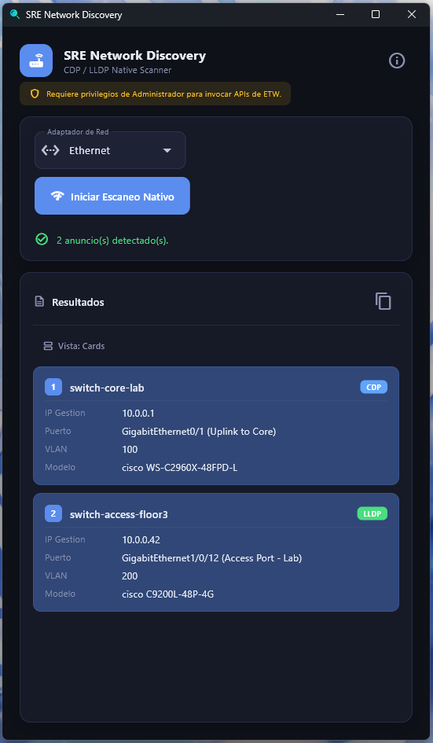
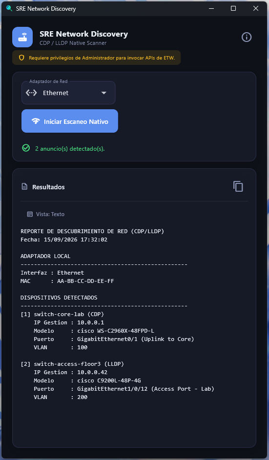

# SRE Network Discovery


Herramienta de escritorio para **descubrimiento de red (CDP/LLDP)** en Windows. Captura anuncios de switches Cisco y otros dispositivos mediante **ETW (Event Tracing for Windows)** sin necesidad de Wireshark ni dependencias externas de captura.

## ✨ Características

- ✅ Captura nativa de **CDP (Cisco Discovery Protocol)** y **LLDP (Link Layer Discovery Protocol)**
- ✅ Extracción de:
  - Nombre del switch
  - IP de gestión (IPv4/IPv6)
  - Puerto local y descripción
  - VLAN (native o tagged)
  - Modelo del dispositivo
  - Descripción del sistema
- ✅ Interfaz gráfica moderna y responsiva construida con **Flet**
- ✅ Vista de resultados en **tarjetas** o **texto plano**
- ✅ Reporte exportable a `Documentos/SRE_Reports/`
- ✅ Sin dependencias externas de captura (usa ETW de Windows)
- ✅ Ejecutable portable, sin instalación

## 📸 Capturas

### Vista de tarjetas



### Vista de texto



## ⚙️ Requisitos

### Para usar el ejecutable

- **Windows 10/11**
- **Privilegios de Administrador** (ETW lo requiere para capturar tráfico de capa 2)

### Para compilar desde código fuente

- **Python 3.10+** (probado en 3.14)
- **Flutter SDK 3.44+** (para compilar el binario)
- **Visual Studio 2022/2026** con la carga **"Desktop development with C++"**

## 🚀 Uso

### Opción 1: Ejecutable precompilado

1. Descarga el último `.zip` desde la sección [**Releases**](https://github.com/RaidenMercury/sre-network-discovery/releases).
2. Descomprime en cualquier carpeta.
3. Ejecuta `sre-network-discovery.exe` **como Administrador** (clic derecho → "Ejecutar como administrador").
4. Selecciona el adaptador de red en el dropdown.
5. Pulsa **Iniciar Escaneo Nativo**.
6. Espera ~62 segundos. Los switches detectados aparecerán en tarjetas.

### Opción 2: Desde código fuente

```bash
git clone https://github.com/RaidenMercury/sre-network-discovery.git
cd sre-network-discovery
pip install -r requirements.txt
python main.py
```

Para compilar el ejecutable:

```bash
flet build windows
```

## 🔍 Cómo funciona

1. La aplicación invoca un script **PowerShell** que crea una **NetEventSession** con un proveedor de captura de paquetes.
2. El filtro de captura acepta paquetes destinados a las MACs multicast de CDP y LLDP:
   - **CDP**: `01-00-0C-CC-CC-CC`
   - **LLDP**: `01-80-C2-00-00-0E`, `01-80-C2-00-00-03`
3. El script parsea los TLVs de cada protocolo y extrae los campos relevantes.
4. Los datos se devuelven como JSON y se muestran en la interfaz.

## ⚠️ Limitaciones

- **Solo Windows** (usa ETW, no disponible en Linux/macOS).
- Requiere que el switch tenga **CDP o LLDP habilitado** en el puerto al que estás conectado.
- Puede no funcionar en puertos de acceso con seguridad estricta o en VLANs aisladas.
- Requiere permisos de administrador en cada ejecución.

## 🧪 Desarrollo

### Estructura del proyecto

```
.
├── main.py                    # Entry point (UI con Flet)
├── discovery.py               # Módulo de captura ETW + parseo CDP/LLDP
├── icono.ico                  # Ícono de la aplicación
├── assets/
│   └── icon_windows.ico       # Ícono para compilación con Flet
├── docs/
│   ├── screenshot-cards.png   # Captura - vista de tarjetas
│   └── screenshot-text.png    # Captura - vista de texto
├── requirements.txt           # Dependencias Python
├── pyproject.toml             # Configuración de Flet y metadatos
├── LICENSE                    # GPL-3.0
└── README.md
```

### Dependencias

- [Flet](https://flet.dev) — Framework de UI
- [psutil](https://github.com/giampaolo/psutil) — Utilidades de sistema (detección de adaptadores)
- [certifi](https://github.com/certifi/python-certifi) — Certificados SSL

## 🤝 Contribuir

Las contribuciones son bienvenidas. Por favor:

1. Haz un **fork** del proyecto.
2. Crea una rama para tu feature: `git checkout -b feature/mi-feature`.
3. Commit con mensajes claros: `git commit -m "Add: nueva funcionalidad"`.
4. Push a tu rama: `git push origin feature/mi-feature`.
5. Abre un **Pull Request** describiendo los cambios.

Antes de enviar un PR, asegúrate de que:
- El código pase las pruebas manuales (escaneo funcional).
- No incluyas datos reales de redes corporativas en capturas o ejemplos.

## 📄 Licencia

Este proyecto está licenciado bajo **GNU General Public License v3.0**. Consulta el archivo [LICENSE](LICENSE) para más detalles.

```
Copyright (c) 2026 RaidenMercury

This program is free software: you can redistribute it and/or modify
it under the terms of the GNU General Public License as published by
the Free Software Foundation, either version 3 of the License, or
(at your option) any later version.

This program is distributed in the hope that it will be useful,
but WITHOUT ANY WARRANTY; without even the implied warranty of
MERCHANTABILITY or FITNESS FOR A PARTICULAR PURPOSE. See the
GNU General Public License for more details.
```

## 🙏 Créditos

- **Autor**: [RaidenMercury](https://github.com/RaidenMercury)
- **Ícono**: Icon made by [Rasama Studio](https://www.flaticon.es/autores/rasama-studio) from [www.flaticon.com](https://www.flaticon.com)
- **Lógica de parseo CDP/LLDP**: Inspirada y traducida desde [PSDiscoveryProtocol](https://github.com/neural-loop/PSDiscoveryProtocol) (licencia MIT). El script PowerShell de este proyecto es una versión condensada y adaptada para ETW nativo.

## 📬 Contacto

- **GitHub**: [@RaidenMercury](https://github.com/RaidenMercury)
- **Issues**: [Reportar un problema](https://github.com/RaidenMercury/sre-network-discovery/issues)

---

⭐ Si este proyecto te resulta útil, considera darle una **estrella** en GitHub.